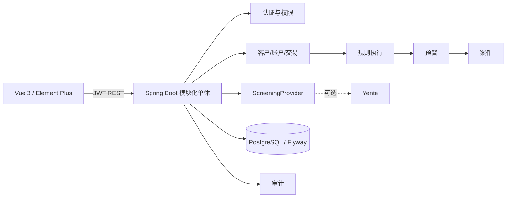

# 系统总体架构设计

模块按业务包隔离，共享部分仅包含基础实体、异常和配置。最小闭环使用单库事务保证命中、预警及状态历史一致性。外部 Fineract/Yente/AMLSim 位于 `integration` 边界，默认不参与核心启动。

## 安全

Spring Security 使用无状态 JWT；密码为 BCrypt cost 12。权限既映射角色，也作为细粒度 authority 在 `@PreAuthorize` 校验。登录连续失败 5 次锁定 15 分钟。生产必须提供随机 JWT 密钥、关闭 dev 初始化并限制 CORS。

## 规则设计

规则定义、版本和执行/命中分表。业务参数保存 JSON，但用户不能提交任意 DRL。当前 AML-R001 由受控 Java 执行器实现；Drools 依赖已验证解析，后续只允许加载应用内受审查模板。
