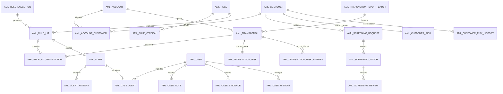

# 数据库设计文档

## 1. 基线与约定

数据库为 PostgreSQL 16，结构由 Flyway V1–V6 唯一管理，应用使用 `spring.jpa.hibernate.ddl-auto=validate`。主键统一为 UUID；时间使用 `timestamptz` 并按 UTC 存储；金额使用 `numeric(19,4)`；业务编号设唯一约束；业务数据不提供物理删除接口。

2026-10-14 在独立空库实测结果：6 条迁移全部 `success=true`，public 下 35 张基础表（34 张应用表加 `flyway_schema_history`）、49 个外键、81 个索引，应用随后通过 Hibernate schema 校验并启动。

## 2. 核心关系



## 3. 表清单

| 领域 | 表 | 用途与关键键 |
|---|---|---|
| 权限 | `sys_user`、`sys_role`、`sys_permission` | 用户、角色、权限；用户名/角色码/权限码唯一 |
| 权限 | `sys_user_role`、`sys_role_permission` | 多对多连接表，复合主键 |
| 审计 | `sys_audit_log` | 操作者、动作、资源、结果、IP、JSON 详情和时间，只追加 |
| 客户 | `aml_customer`、`aml_customer_kyc` | 客户主数据及 KYC 占位记录；客户编号唯一，只存脱敏证件号 |
| 客户风险 | `aml_customer_risk`、`aml_customer_risk_history` | 每客户一个当前快照和只追加评分历史 |
| 账户 | `aml_account`、`aml_account_customer` | 账户及客户关系；账户编号唯一，关系表复合主键 |
| 交易 | `aml_transaction_import_batch`、`aml_transaction` | 导入批次和流水；`source + external_id` 唯一 |
| 交易风险 | `aml_transaction_risk`、`aml_transaction_risk_history` | 每交易一个当前快照和只追加评分历史 |
| 筛查 | `aml_screening_request`、`aml_screening_match`、`aml_screening_review` | 请求、候选和人工复核；保存真实/模拟来源 |
| 规则 | `aml_rule`、`aml_rule_version`、`aml_rule_execution` | 定义、不可覆盖的参数版本和每次执行记录 |
| 命中 | `aml_rule_hit`、`aml_rule_hit_transaction` | 稳定 `hit_key` 去重；支持一个窗口命中关联多笔交易 |
| 预警 | `aml_alert`、`aml_alert_transaction`、`aml_alert_history` | 一个命中最多一个预警，保存交易集合与状态历史 |
| 案件 | `aml_case`、`aml_case_alert`、`aml_case_note` | 案件、预警关联和调查笔记；当前一条预警最多进入一个案件 |
| 案件 | `aml_case_evidence`、`aml_case_history` | 证据元数据/逻辑移除和状态历史 |
| 报表 | `aml_report`、`aml_report_generation` | 预留报表任务与产物元数据；当前即时 CSV 不写这两表 |

## 4. 重要字段和约束

- 客户：`customer_type` 为 `INDIVIDUAL/ORGANIZATION`，风险为 `LOW/MEDIUM/HIGH`，状态为 `ACTIVE/INACTIVE`，国家码为两位大写字母。
- 账户：币种为三位大写字母；状态 `ACTIVE/FROZEN/CLOSED`；关闭状态必须有 `closed_at`，非关闭状态不得有；关系为 `OWNER/JOINT_OWNER/AUTHORIZED_SIGNER`，所有权比例范围 `(0,100]`。
- 交易：金额必须大于 0；方向 `IN/OUT`；只允许向活动账户导入，币种须匹配账户；重复流水计入批次重复数但不重复入库。
- 规则：R001–R003 为 `IMPLEMENTED`，R004–R008 为 `PLANNED` 且禁用；规则版本由 `(rule_id, version_no)` 唯一。
- 命中与预警：`aml_rule_hit.hit_key` 唯一，`aml_alert.rule_hit_id` 唯一，共同保证重复执行不重复预警。
- 案件：状态为 `OPEN/INVESTIGATING/PENDING_REVIEW/CLOSED`；状态变更写历史。关闭后服务层拒绝分派、笔记、证据和流转。
- 证据：保存受控 `storage_key`、MIME、字节数和 SHA-256。逻辑移除时 `active=false`，且必须同时保存移除时间、人员、原因；物理文件保留用于审计。
- 筛查：请求的 `provider_mode`、候选的 `data_mode` 只允许 `REAL/SIMULATED`；请求失败保存错误和完成时间，不伪造空成功。
- 风险：当前表为查询快照，历史表每次计算均追加；来源为 `NONE/REAL/SIMULATED/MIXED`。

## 5. 索引与查询路径

- 客户：名称、风险等级；账户：状态、客户关系。
- 交易：`account_id + transaction_time desc`、时间、来源+时间、批次。
- 规则命中：规则+创建时间、客户+创建时间、命中交易反向索引。
- 预警/案件：状态+创建时间、客户、分派调查员、关联表。
- 筛查/评分：客户+时间、请求、复核状态、交易/客户历史时间。
- 审计：发生时间倒序以及 `resource_type + resource_id`。

统计服务使用参数化 SQL 和上述索引；报表日期按 Asia/Shanghai 自然日转换为 UTC 半开区间 `[start,end)`。

## 6. Flyway 迁移说明

| 版本 | 文件 | 内容 |
|---|---|---|
| V1 | `V1__initial_schema.sql` | 主要表、RBAC 初始数据、R001–R008 初始定义 |
| V2 | `V2__customer_account_transaction_modules.sql` | 客户/账户/交易检查约束和查询索引 |
| V3 | `V3__rule_engine_and_alerts.sql` | 实现状态、执行窗口、命中多交易关系和索引 |
| V4 | `V4__disable_planned_rules.sql` | 禁用未实现规则，防止误执行 |
| V5 | `V5__case_investigation.sql` | 证据逻辑移除字段、约束和案件索引 |
| V6 | `V6__screening_and_risk_scoring.sql` | 筛查失败/来源/复核状态、交易风险表和风险来源 |

不得修改已经在环境中执行过的脚本。变更应新增下一版本，先在备份副本演练，再执行应用启动。校验命令：

```powershell
docker compose exec -T postgres psql -U aml -d aml -c `
  'select installed_rank,version,description,success from flyway_schema_history order by installed_rank'
```

## 7. 备份、恢复与敏感数据

开发备份可用 `pg_dump -Fc`，恢复到新库后必须核对 Flyway 校验和、表数和关键行数。生产应使用独立账号、TLS、加密备份、密钥托管、行级保留策略和最小权限。本演示库只保存脱敏证件号；不得导入真实客户、制裁名单副本或生产凭据。
