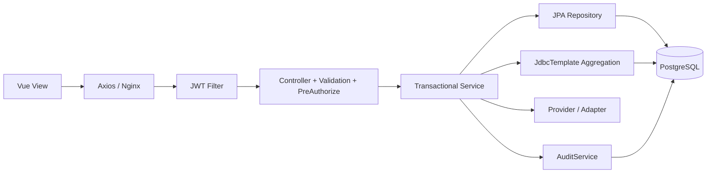

# 源码学习与二次开发指南

## 1. 仓库结构

```text
java-aml-platform/
├─ backend/                 Spring Boot 后端与测试
│  └─ src/main/java/com/example/aml/
│     ├─ auth,security,user 登录、JWT、RBAC
│     ├─ customer,account,transaction 客户到账户到交易
│     ├─ rule,alert,casework 规则、预警、调查
│     ├─ screening,risk     名单筛查与风险评分
│     ├─ dashboard,audit    统计、CSV 与审计
│     ├─ integration        外部系统适配器
│     └─ common             通用实体、异常、CSV 安全编码
├─ frontend/src/            Vue 路由、状态、API 和业务页面
├─ integrations/            合成示例文件
├─ scripts/e2e-smoke.ps1    真实 HTTP 冒烟链路
├─ docs/                    设计、接口、部署、验证记录
└─ compose.yaml             PostgreSQL/后端/前端编排
```

## 2. 推荐阅读顺序

1. `AmlApplication`、`application.yml`、`application-dev.yml`：启动、数据库、外部适配和 demo 开关。
2. `SecurityConfig`、`JwtService`、`AuthController`、`PlatformUserDetailsService`：无状态 JWT 和方法级权限。
3. `V1`–`V6` Flyway：先理解真实表、约束和初始权限，再看 JPA；Hibernate 不负责建表。
4. `customer`→`account`→`transaction`：标准 Entity/Repository/DTO/Service/Controller 分层与导入事务。
5. `RuleExecutionService` 和 `DroolsRuleEvaluator`：数据库聚合事实、受控规则模板、稳定 `hit_key`、命中和预警同事务写入。
6. `AlertService`、`CaseService`、`CaseEvidenceService`：状态机、行锁、证据路径/MIME/哈希和审计。
7. `ScreeningProvider`、Mock/Yente、`RiskScoringService`：端口适配、故障边界、真实/模拟来源传播和评分历史。
8. `DashboardService`、`ReportExportService`、`AuditQueryService`：真实 SQL、时区区间、权限和 CSV 公式注入防护。
9. `frontend/src/router`、`stores/auth.ts`、`api/http.ts`、各 View：懒加载页面、权限导航、401 清理和状态呈现。
10. `CoreWorkflowIntegrationTest` 与 `scripts/e2e-smoke.ps1`：最完整的业务用例和验收契约。

## 3. 请求如何流动



Controller 负责 HTTP、DTO 和权限；Service 负责业务不变量和事务；Repository/JdbcTemplate 负责持久化。聚合报表和多表详情采用参数化 SQL，主数据采用 JPA。写操作尽量在同一事务中写业务记录和审计记录。

## 4. 关键设计点

- DTO 与实体分离，枚举限制状态，Bean Validation 处理格式和长度，数据库检查约束作为最后防线。
- 所有分页入口限制 page/size；审计 size 最大 100，导出最多 10000 行。
- 规则配置只接受 R001–R003 的白名单参数，不接收任意 DRL，避免远程规则代码执行。
- R001 以规则版本+客户+交易生成命中键；窗口规则以排序交易集合生成稳定 UUID。数据库唯一键承担最终幂等保证。
- 案件状态使用显式允许边，`for update` 防并发流转；关闭后不可变。
- 证据文件名去路径，只允许 PDF/PNG/JPEG/TXT/CSV，限制 10MB，随机 storage key，解析后路径必须位于根目录。
- CSV 输出始终双引号转义；以 `= + - @` 等危险前缀开始的外部值加单引号，防止电子表格公式注入。
- `REAL/SIMULATED/MIXED/NONE` 是业务数据的一部分，不能仅靠页面文案区分。

## 5. 新增业务模块

1. 新增 `V7__description.sql`，包含外键、唯一键、检查约束和查询索引。
2. 增加领域实体/Repository；定义输入和输出 DTO，不直接暴露可写实体。
3. Service 中实现校验、事务、幂等和 `AuditService.record`。
4. Controller 添加 Bean Validation 和最小权限 `@PreAuthorize`。
5. 增加单元测试；涉及数据库、权限或工作流时扩展 Spring Boot/MockMvc 集成测试。
6. 增加前端页面或组件，处理 loading、empty、error、403，路由和导航按权限显示。
7. 执行后端测试、前端构建、全新 PostgreSQL 迁移和 E2E；同步文档。

## 6. 新增规则

不要直接开放用户上传 DRL。推荐流程：新增固定规则码和参数 JSON Schema/白名单；在 `RuleParameterValidator` 校验；在 `RuleExecutionService` 构造事实；在受控 Drools 模板中判断；定义跨重试稳定的命中键；同时测试阈值边界、时间边界、重复执行和并发唯一冲突。图规则应单独设计图模型和批处理边界，完成前保持 `PLANNED/disabled`。

## 7. 新增外部适配器

先定义领域接口，再写 HTTP 适配器；所有 URL、凭据、租户、阈值和超时外置；映射时保存来源；测试成功、禁用、超时、非 2xx 和坏 JSON。失败必须返回明确错误并记录失败状态/审计，禁止静默生成空结果或切换 Mock。集成文档只记录实际实连结果。

## 8. 测试分层

- 单元测试：参数、状态机、解析、映射、失败分支、安全编码。
- Spring 集成测试：JWT/RBAC、HTTP、事务、完整 AML 闭环；test profile 使用 H2 的 PostgreSQL 兼容模式。
- Flyway 测试：独立 PostgreSQL 空库执行 V1–V6，再让应用以 `ddl-auto=validate` 启动。
- 运行 E2E：Compose 上执行 `scripts/e2e-smoke.ps1`，写入明确的合成记录并保留审计。
- 前端：`vue-tsc -b && vite build`；当前未配置组件单测和浏览器自动化，这是已知缺口。

## 9. 当前技术债务

- Spring Data `PageImpl` 直接序列化会输出稳定性告警，未来应统一为自定义分页 DTO，并同步前端字段。
- Element Plus 全量注册使 vendor chunk 约 917 KB；应改为按需组件/样式导入。
- 测试中少量 Mockito deprecated/unchecked 编译提示待清理。
- H2 集成测试不能替代 PostgreSQL Testcontainers；目前通过独立空库迁移和真实运行 E2E 补足。
- 尚无前端单元测试、浏览器回归、CI、SBOM 和自动漏洞门禁。
